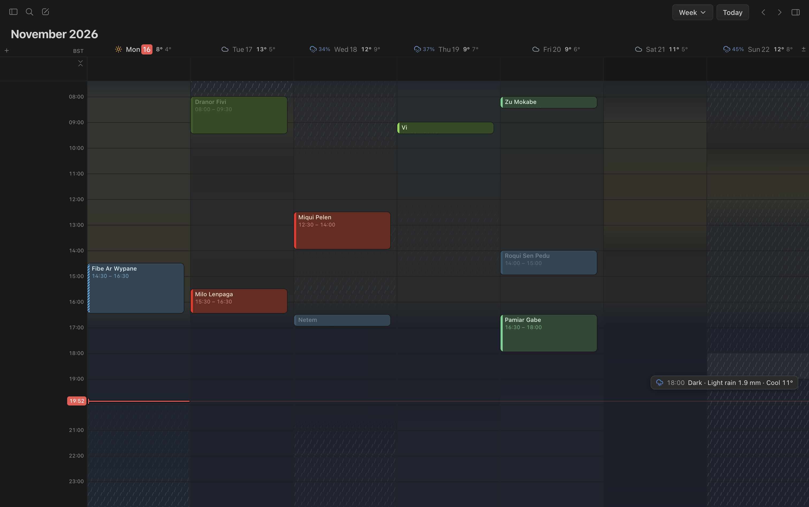
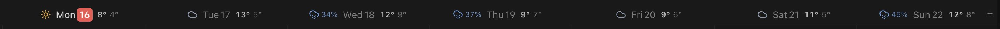
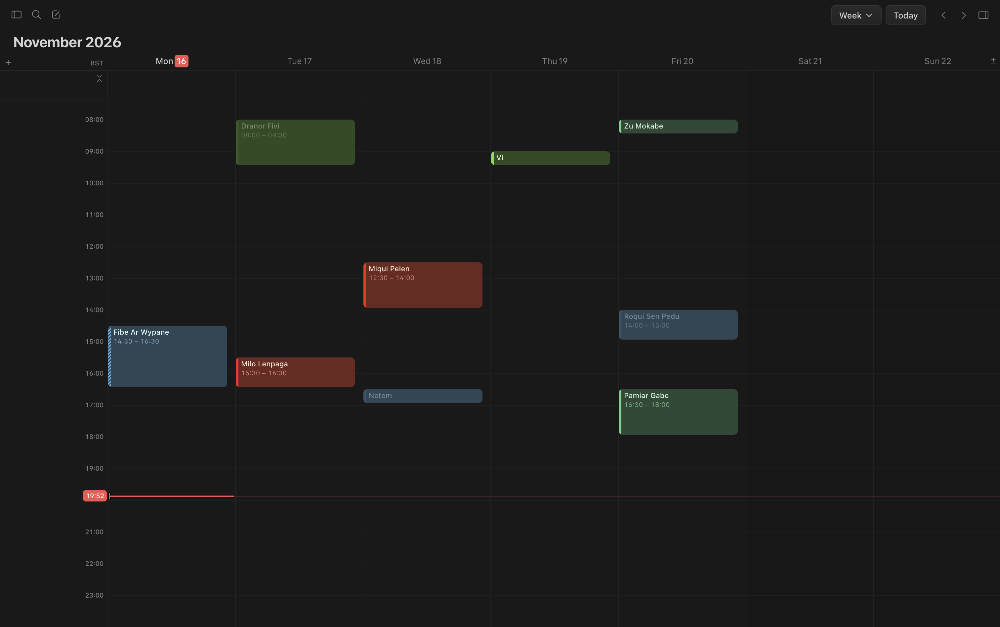
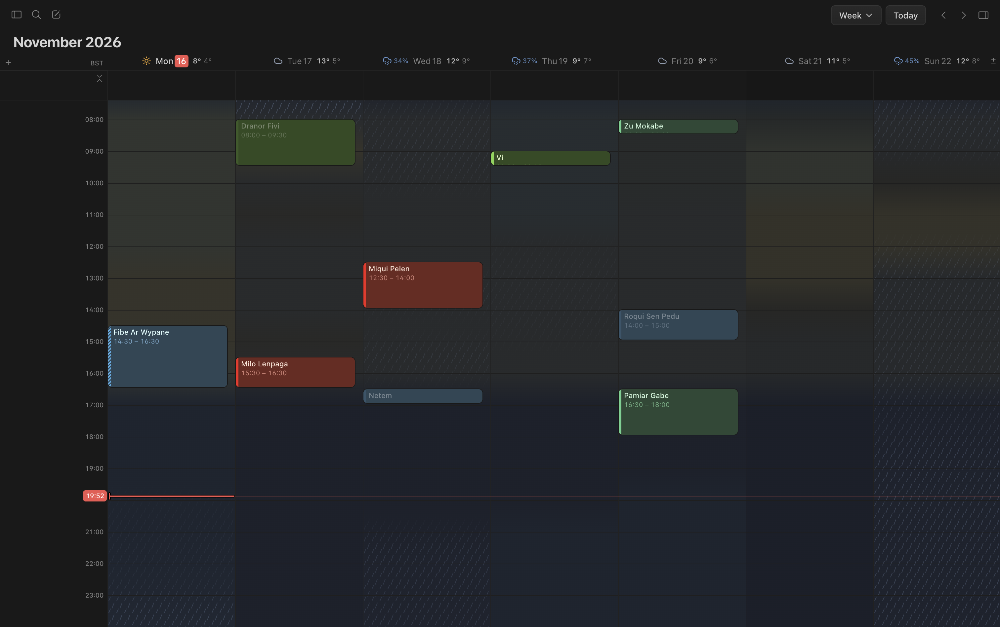

# Weather in Notion Calendar

**See what it's like outside, hour by hour, right where you plan your week.**



## The problem

A calendar tells you *when* you're free. It doesn't tell you what that time will *feel* like.

So we plan around the weather in a second app: is the 6pm run going to be in the rain? Will it already be
dark when I leave the office? Should the coffee walk be today or tomorrow? We flip back and forth, and the
calendar, the place where the decision gets made, knows nothing about it.

## The feature

Weather becomes part of the calendar's surface instead of another thing to read.

**The background carries the feel of each hour.** Every day column gets a quiet, continuous wash that
changes hour to hour with three signals:

- **Light:** warm and bright when it's sunny, flat grey when overcast, deep navy after dark.
- **Cold:** an icy cast when it's cold, a warm one when it's warm.
- **Rain:** fine streaks that appear while it rains. Denser streaks mean heavier rain.

<p align="center">
  <br>
  <sub>A dry day next to a rainy evening. The streaks fade in and out with the rain, hour by hour.</sub>
</p>

**The day header gives the summary:** an icon and the high and low beside each date, plus the chance of
rain on wet days.



**Hover for the exact hour:** pointing at any empty slot shows `18:00 · Dark · Light rain 1.9 mm · Cool 11°`
(bottom right of the screenshot at the top). These are the same words as the three signals, so you learn to
read the background without a legend.

| Today | With weather |
|---|---|
|  |  |

## Principles

1. **Events always win.** Weather is painted underneath the grid. Events, hour lines and text are
   untouched, and nothing ever covers them.
2. **Glanceable, not readable.** You should get "rainy evening, dark by five" in under a second without
   reading a number. The numbers are one hover away.
3. **One signal per question.** Light, cold and rain each have their own visual channel (brightness, hue
   and texture), so they never blur into each other.
4. **Honest data.** Rain is drawn in the hour it actually falls, its density follows the measured amount,
   and a sunny day never shows a rain chance it doesn't deserve.
5. **Zero setup.** The location follows the calendar's time zone, and you can change it whenever you like.

## Try the prototype

This repo is a working prototype for the macOS desktop app. It builds a separate, patched copy of your
installed Notion Calendar and never modifies the original. No Notion code is included here.

```sh
npm install
npm run app:update   # downloads + verifies the latest Notion Calendar, builds ~/Applications/Notion Calendar Weather.app
open ~/Applications/Notion\ Calendar\ Weather.app
```

Run `npm run app:update` again, or schedule it (see [docs/DEVELOPMENT.md](docs/DEVELOPMENT.md#updates)),
and new Notion releases arrive through the app's usual "Restart and upgrade" prompt.

Requires macOS and Node 24 (no need to have Notion Calendar installed). Your calendar data never leaves
the app; the only outside request is the forecast for your location. See
[docs/DEVELOPMENT.md](docs/DEVELOPMENT.md) for how it works.

**Status:** prototype. Week view, dark theme. Month view, light theme and a location picker aren't built yet.

---

*An independent project, not affiliated with or endorsed by Notion. The events in the screenshots are
randomly generated placeholders. Weather data by [Open-Meteo](https://open-meteo.com/) (CC BY 4.0).*
